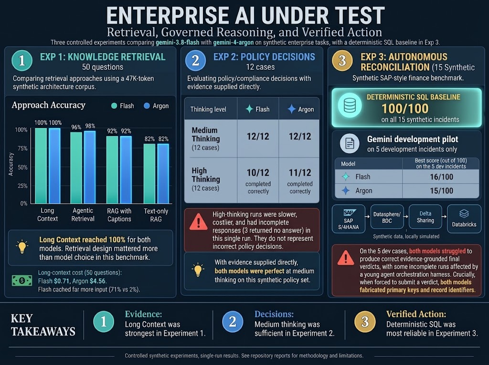

# Enterprise AI Under Test: Retrieval, Governed Reasoning, and Verified Action

*Three controlled experiments comparing `gemini-3.8-flash` with `gemini-4-argon` on synthetic enterprise tasks, with a deterministic SQL baseline added in Experiment 3.*



This repository holds three controlled experiments run on 2026-10-13 to 2026-10-17, shortly after Gemini 4 Argon became generally available. Each compares `gemini-4-argon` with `gemini-3.8-flash` on synthetic but realistic enterprise work, scores results deterministically (against a frozen answer key in Experiments 1 and 2, or an independent grader with a strong non-LLM baseline in Experiment 3), and reports cost, latency and tokens from API usage fields. Experiment 3 evaluates the SQL baseline on all 15 incidents but runs the two models on the 5 development incidents only. Each experiment was run once; results apply to these tasks and dates only.

| | Experiment 1: knowledge retrieval | Experiment 2: architecture review decisions | Experiment 3: autonomous reconciliation |
|---|---|---|---|
| Question | When should an architect choose classic RAG, long context or agentic retrieval? | With all evidence in context, does Argon make better multistep decisions than Flash? | With identical tools and an independent grader, can either model autonomously investigate a reconciliation discrepancy — and does a frontier model beat a cheaper one, or no model at all? |
| Task | 50 questions over a 47K token architecture corpus, including 4 diagrams | 12 vendor integration proposals judged against a 16 document policy pack (about 4.4K tokens) | 15 synthetic reconciliation incidents on a simulated SAP S/4HANA to Databricks path; find the root cause, the exact affected records and a safe remediation, then verify the repair |
| Configurations | 4 retrieval designs x 2 models, medium thinking | 2 models x 2 thinking levels (medium, high), no retrieval | 2 models x medium thinking, 5 bounded tools, multi-turn function calling; plus a deterministic SQL baseline |
| Accuracy | Long context 50/50 for both models. RAG and agentic arms 41 to 49; the two models missed the same questions except one (D01, agentic) | Medium thinking 12/12 for both models. No incorrect decision in any configuration; 3 high thinking calls returned no answer | Deterministic SQL baseline: 100/100 on all 15 incidents (5 development + 10 frozen test). The two models were run on the 5 development incidents only (frozen test sealed) and never exceeded 16/100: often no verdict submitted, and fabricated record identifiers when forced to submit |
| Cost (usage based estimates) | Argon about 6.4 times Flash in long context ($4.56 against $0.71 for 50 questions) | Argon about 1.3 times Flash at medium ($0.211 against $0.163 for 12 cases) | Argon about 3 to 4 times Flash per case ($0.09-0.17 against $0.02-0.04), with no accuracy benefit; about $1.55 total live spend |
| Other differences | Most errors coincided with evidence the retrieval step did not supply; Flash cached far more of its input (71% against 2% in long context) | In this single run, Argon medium had the lowest latency and token use; high thinking cost 3 to 6 times more and was less reliable | Both models queried the right data layers (partial evidence credit) but did not turn investigation into a grounded, correct verdict; Argon was slower and completed less often. Completion was also constrained by a young orchestration harness, so the incomplete runs are not a clean measure of model reasoning |
| Main limitation | Single run, synthetic corpus, untuned retrieval | Ceiling effect (both medium arms perfect), single run, crisp synthetic rules | Single trial, 5 development cases only (10-case frozen test sealed), synthetic data, young agent harness |
| Details | Sections 1 to 11 below | [`experiments/arb/README.md`](experiments/arb/README.md) and [`REPORT.md`](experiments/arb/REPORT.md) | [`experiments/finance-reconciliation/README.md`](experiments/finance-reconciliation/README.md) and [`REPORT.md`](experiments/finance-reconciliation/REPORT.md) |

**Combined reading.** The three experiments form an arc: retrieving evidence (1), reasoning over evidence already supplied (2), then gathering evidence with tools and acting on it (3). In Experiments 1 and 2 the cheaper model was sufficient: its errors were almost entirely shared with Argon's and mostly coincided with evidence that retrieval did not supply (Experiment 1) or with calls that never completed (Experiment 2), not with reasoning mistakes Argon avoided. Experiment 3 is a candid negative result for both models on the 5 development incidents: a strong deterministic SQL baseline solves all 15 synthetic incidents, but neither model turned its investigation into a grounded, correct, structured verdict. Two things should be read apart here. The frequent incomplete runs were shaped in part by a young orchestration harness (the loop and the Interactions-API multi-turn integration were being brought up during these pilots), so they are not a clean measure of model reasoning. The fabrication finding is separate and concerns the content of the verdicts the models did submit: on completed cases both reported record identifiers that do not exist in the data, with zero overlap with the true affected keys. Argon cost more in all three experiments; its only measured advantages were one agentic retrieval question in Experiment 1 and, in a single run, lower latency and token use at medium thinking in Experiment 2. None of the three included enough cases where the models diverged to establish a difference in reasoning strength, and none should be read as a verdict that one model beats the other.

Status: all three experiments are closed. Experiment 3's live pilots were run on the development set only; its 10-case frozen test set remains sealed. No paid runs have been made since 2026-10-17. Costs throughout are estimates from API usage fields and have not been reconciled with billing.

---

# Experiment 1: Long Context vs RAG vs Agentic Retrieval

**Research question:** when should an enterprise AI architect choose classic RAG, long context inference, or agentic retrieval?

A new architect asks 50 questions about a synthetic company's architecture documentation (about 47K tokens). The experiment compares four retrieval designs on both models, scores every answer deterministically against a frozen answer key, and reports cost, latency and caching from API usage fields. Main benchmark completed 2026-10-14; nothing in this section was changed by Experiment 2.

## 1. Headline results (main benchmark, valid)

Run file: `results/runs/test_20261013_235517.jsonl`. Scores: `results/scores/test_20261013_235517_summary.csv`. One execution, medium thinking level, 50 test questions, 400 model runs, usage based cost estimate **$8.31** (excluding embeddings; see section 10).

All costs in this README are **usage based estimates** computed from API usage fields and published prices. They have not been reconciled against billing.

| Approach | Model | Answer accuracy (of 50) | Est. cost | Est. cost per question | Mean latency | Cached input tokens (total) | Superseded citations* |
|---|---|---|---|---|---|---|---|
| Long context | Gemini 3.8 Flash | **50 (100%)** | $0.71 | $0.014 | 6.6 s | 1,614,299 | 0 of 42 |
| Long context | Gemini 4 Argon | **50 (100%)** | $4.56 | $0.091 | 9.2 s | 44,075 | 3 of 42 |
| Agentic retrieval | Gemini 3.8 Flash | 48 (96%) | $0.23 | $0.005 | 20.1 s | 325 | 2 of 42 |
| Agentic retrieval | Gemini 4 Argon | 49 (98%) | $1.34 | $0.027 | 23.9 s | 256,559 | 3 of 42 |
| RAG with diagram captions | Gemini 3.8 Flash | 46 (92%) | $0.25 | $0.005 | 6.1 s | 2,531 | 1 of 42 |
| RAG with diagram captions | Gemini 4 Argon | 46 (92%) | $0.43 | $0.009 | 12.7 s | 66,483 | 2 of 42 |
| Classic RAG, text only | Gemini 3.8 Flash | 41 (82%) | $0.25 | $0.005 | 5.0 s | 0 | 1 of 42 |
| Classic RAG, text only | Gemini 4 Argon | 41 (82%) | $0.56 | $0.011 | 6.0 s | 0 | 4 of 42 |

\* Answers to the 42 answerable questions whose citations include a document version that the answer key marks as superseded. Section 1b shows that all of these are historical references made alongside the current version, not reliance on outdated authority.

Unanswerable questions: every approach and both models answered `not_found` on all 8 (no hallucinated values).

### 1b. Publication metrics (added in the hardening pass, same raw data)

Computed offline by `metrics.py` from the unchanged JSONL; full table in `results/analysis/test_20261013_235517_metrics.md`. Answer accuracy above is unchanged.

| Approach | Model | Answer accuracy | Answerable correct (of 42) | Correct abstentions (of 8) | Evidence valid | Reviewed accuracy† | Superseded: historical / outdated authority | Doc level retrieval recall‡ |
|---|---|---|---|---|---|---|---|---|
| Long context | Flash | 50/50 | 42 | 8 | 50/50 | 50/50 | 0 / 0 | n/a |
| Long context | Argon | 50/50 | 42 | 8 | 50/50 | 50/50 | 3 / 0 | n/a |
| Agentic retrieval | Flash | 48/50 | 40 | 8 | 48/50 | 49/50 | 2 / 0 | 0.976 |
| Agentic retrieval | Argon | 49/50 | 41 | 8 | 49/50 | 50/50 | 3 / 0 | 1.000 |
| RAG with captions | Flash | 46/50 | 38 | 8 | 46/50 | 46/50 | 1 / 0 | 0.917 |
| RAG with captions | Argon | 46/50 | 38 | 8 | 46/50 | 46/50 | 2 / 0 | 0.917 |
| Text RAG | Flash | 41/50 | 33 | 8 | 41/50 | 41/50 | 1 / 0 | 0.798 |
| Text RAG | Argon | 41/50 | 33 | 8 | 41/50 | 41/50 | 4 / 0 | 0.798 |

Definitions:
* **Answer accuracy:** the original deterministic score (key facts matched, status correct). Unchanged from the published run.
* **Answerable correct vs correct abstentions:** accuracy on the 42 answerable questions reported separately from `not_found` on the 8 unanswerable ones, so abstention cannot inflate the headline.
* **Evidence valid:** correct **and** every required current citation (`DOC_ID@VERSION`) present. For unanswerable questions it equals correct. In this run every correct answer was also evidence valid, so the two columns match.
* **Superseded: historical vs outdated authority:** an answer that cites a superseded version **and** all required current versions is a historical reference (for example citing the original contract next to its amendment). One that cites a superseded version without the current one relies on outdated authority. Observed: 16 historical, **0 outdated authority**.
* † **Reviewed accuracy:** applies only the documented overrides in `results/review/manual_review.json`. There are two, both C05 in the agentic arm: the frozen pattern `\b8\s*(seconds|s\b)` rejects the singular phrase "8 second timeout", while the answer is correct and cites the required SPEC-PAY-INT@v2. The original score is kept; the review is a separate column.
* ‡ **Doc level retrieval recall:** the share of required documents that appear anywhere among the retrieved chunks' source documents. It does **not** show that the specific passage containing the answer was retrieved; chunk level evidence retrieval was not validated. Long context retrieves nothing and has no recall value.

**Token usage per question (means from API usage fields; `results/analysis/test_20261013_235517_results_table.md`):**

| Approach | Model | Input tokens | Output tokens | Thinking tokens | Share of input cached | Median latency | Tool calls |
|---|---|---|---|---|---|---|---|
| Long context | Flash | 45,633 | 71 | 390 | 71% | 5.9 s | 0 |
| Long context | Argon | 45,556 | 95 | 73 | 2% | 7.1 s | 0 |
| Agentic retrieval | Flash | 2,889 | 205 | 456 | 0% | 18.9 s | 5.3 |
| Agentic retrieval | Argon | 16,325 | 229 | 161 | 31% | 18.8 s | 5.4 |
| RAG with captions | Flash | 4,782 | 73 | 290 | 1% | 5.1 s | 0 |
| RAG with captions | Argon | 4,913 | 104 | 20 | 27% | 4.7 s | 0 |
| Text RAG | Flash | 4,789 | 73 | 303 | 0% | 4.8 s | 0 |
| Text RAG | Argon | 4,922 | 101 | 26 | 0% | 4.9 s | 0 |

Cost check (estimate): Argon long context, 45,556 input tokens at $2 per million plus about 170 output and thinking tokens at $10 per million gives about $0.093, against $0.091 logged (the difference is the few cached tokens). The cost formula is consistent with the usage fields.

## 2. Findings (measured, this experiment only)

1. **At about 47K tokens, long context was the most accurate approach for both models (100%).** Gemini 3.8 Flash matched Gemini 4 Argon's accuracy at about one sixth of the estimated cost ($0.71 vs $4.56). Long context was also the only approach in which the models saw the diagram images themselves (section 3).
2. **Most RAG misses coincided with missing retrieved evidence, and errors were identical across models.** Argon and Flash produced identical accuracy in every question category under both RAG variants. X07 failed because the required policy document was not retrieved, and D01 and D02 are consistent with the caption chunk not ranking in the top 8 (chunk level retrieval was not validated). D08 is different: both models over inferred from suggestive contract text, a reasoning error rather than a retrieval miss (section 6).
3. **Diagrams need an explicit path into text RAG.** Text only RAG answered 0 of 8 diagram questions (abstaining on D01 to D07, an incorrect answer on D08). Adding frozen captions raised this to 5 of 8; long context, which sees the images directly, answered 8 of 8. Because the captions were written by Flash, this compares access paths, not the two models' vision.
4. **Agentic retrieval closed most of the gap to long context** (96% Flash, 98% Argon by the original score; 98% and 100% after the documented C05 review) at a fraction of long context estimated cost, but was the slowest approach (about 20 to 24 s per question).
5. **Argon cited superseded document versions more often than Flash** in all four approaches (3 vs 0, 3 vs 2, 2 vs 1, 4 vs 1 of 42). On review, all 16 cases cite the current version as well (historical reference); none relies on outdated authority, and none changed an answer's correctness. The difference matters only for how clean the citation trail is.
6. **Caching behaved very differently** (section 5): 71% of Flash's long context input was served from cache, 2% of Argon's.
7. **At the medium thinking level, Flash used more thinking tokens than Argon** in every approach (for example 390 vs 73 per question in long context, 290 vs 20 in RAG with captions). Argon's higher cost came from its input price and missed caching, not from thinking.
8. **As agents, the two models explored differently:** both made about 5.4 tool calls per question, but Argon took in about 16K input tokens per question against Flash's 2.9K. The tool call logs in the raw JSONL show why: per question, Argon called `read_doc` 3.42 times and `search_docs` 1.26 times; Flash called `read_doc` 2.42 times and `search_docs` 2.24 times (`list_docs` 0.74 vs 0.66). Argon read more whole documents and searched less.
9. **Mean latency hides outliers:** Argon RAG with captions averaged 12.7 s but its median was 4.7 s, so a few slow requests dominate the mean. Medians are reported alongside means.

## 3. The four approaches

All four use the same system prompt, the same answer schema (`status`, `answer`, `citations` as `DOC_ID@VERSION`) and the same questions. Code: `src/argon_lab/arms.py`.

* **Long context (L):** every document, plus the four diagram PNGs as images, is sent with each question. The corpus comes first in a fixed order and the question last, so a cache could reuse the prefix. No retrieval step.
* **Classic RAG, text only (R1):** documents are split into section aware chunks of about 800 tokens, embedded once with `gemini-embedding-2`, and the 8 most similar chunks are sent with the question. Diagrams are not indexed, so diagram answers are out of reach by design.
* **RAG with diagram captions (R2):** the same as R1, plus a text caption of each diagram, generated once by Gemini 3.8 Flash from the PNG and frozen in `corpus/small/captions/` before the run. This is the fair visual comparison for text RAG; it inherits Flash's reading of the diagrams.
* **Agentic retrieval (A):** the model gets only the question and three read only tools: `list_docs`, `search_docs` (the R2 index) and `read_doc`. It decides what to search and read, for at most 8 rounds. Diagrams are available to it through their captions.

**Image access differs by approach, and this matters for every diagram result:**

| Approach | What the model sees for the 4 diagrams | What a diagram score measures |
|---|---|---|
| Long context (L) | The PNG images themselves | The tested model's own image understanding |
| RAG with captions (R2) | Text captions written once by Gemini 3.8 Flash, if retrieved in the top 8 | Retrieval of the caption plus reasoning over Flash's description |
| Agentic retrieval (A) | The same Flash captions, through `search_docs` and `read_doc`; no images | Search and reading behavior plus reasoning over Flash's description |
| Text RAG (R1) | Nothing | Abstention when the evidence is absent |

So Argon's vision was exercised only in long context. In R2 and A, both models read Flash's interpretation, and any caption error would affect both equally.

## 4. Corpus and questions

* Synthetic company Northwind Logistics: 31 text documents (decision records, API specs, contracts, runbooks, postmortems, policies, service catalogs, and 6 deliberately irrelevant documents) plus 4 diagrams. About 47K text tokens.
* Documents were generated from a structured fact base (`corpus/spec/corpus_spec.json`); answers come from the fact base, never from model output.
* 50 test questions in five categories: single fact (12), cross document (12), conflicting versions (10), diagram (8), unanswerable (8). Plus 10 separate dev questions used only for the pilot.
* `corpus/check_corpus.py` verifies that every answer key fact exists in its cited documents, and that diagram only facts and unanswerable facts appear in no text document (0 problems at freeze).
* Freeze commits: corpus and questions **b9b8bbb**, line endings **fb2b5da**, runner and frozen captions **e10ac9c**, results **07e6f58**.

## 5. Caching: what we observed

These observations cover our requests on 2026-10-13 and 2026-10-14 only. Google documents implicit caching as best effort with no guarantee, and the behavior may differ at other times or volumes.

* **Probes, Argon, identical ~11.4K token prefix, 21 requests** (counts taken from the probe console output; the probe result files are not yet in this repository): resending the full prefix each time: 0 of 11 substantial hits. A conversation chain held on the server (`previous_interaction_id`): 2 of 3 hits. Branching every question from one corpus loading interaction: 1 of 7 hits.
* **Main benchmark, long context (about 52K token prefix, 50 requests each):** Flash reported 1,614,299 cached tokens and its per question cost fell from about $0.035 to about $0.006 on most questions. Argon reported 44,075 cached tokens; its cost stayed at about $0.092 per question except one question ($0.010).
* Argon's agentic runs reported 256,559 cached tokens, which fits the probe finding that Argon cached within server held conversation chains.
* No caching savings are claimed beyond what `total_cached_tokens` reports.

## 6. Error analysis by category

| Category | Long context | Agentic | RAG with captions | Text RAG |
|---|---|---|---|---|
| Single fact (12) | 12 / 12 both | 12 / 12 both | 12 / 12 both | 12 / 12 both |
| Cross document (12) | 12 / 12 both | 12 / 12 both | 11 / 12 both | 11 / 12 both |
| Conflicting versions (10) | 10 / 10 both | 9 / 10 both | 10 / 10 both | 10 / 10 both |
| Diagram (8) | 8 / 8 both | Argon 8, Flash 7 | 5 / 8 both | 0 / 8 both |
| Unanswerable (8) | 8 / 8 both | 8 / 8 both | 8 / 8 both | 8 / 8 both |

Counts use the original answer accuracy. Every miss, with the models' answers and citations, is in `results/analysis/test_20261013_235517_error_report.md`.

* **X07, cross document, all four RAG cells:** both models in both RAG variants missed the mTLS requirement because POL-SEC-01@v2 was not among the retrieved documents. Long context and the agent answered it.
* **D01 and D02, diagrams, RAG with captions:** both models answered `not_found` on D01 (sync or async call to PayNimbus) and D02 (Kafka topic between shipping and carrier services), whose answers are in the DIAG-01 caption. This is consistent with the caption chunk not ranking in the top 8; chunk level retrieval was not separately validated.
* **D08, diagrams, both RAG variants:** both models answered that no component sits between the services, where the diagram shows carrier-gateway. The text of CT-SWIFT-2024@v1 says carrier-gateway "talks to the SwiftShip API on our behalf" and is the "single integration point", so the corpus wording is suggestive and the models over inferred from it. This is a corpus design weakness, recorded rather than corrected, since the questions are frozen.
* **D01 to D07, text RAG:** both models abstained, as expected with no diagram access.
* **D01, agentic Flash:** answered `not_found`.
* **C05, conflicting versions, agentic (both models):** a scorer false negative, not a model error. The answer "8 second timeout" is correct and cites SPEC-PAY-INT@v2, but the frozen pattern requires "seconds" or "s". Kept as a miss in answer accuracy; corrected only in the reviewed column (section 1b).

## 7. The retrieval bug in the pilot (invalid results, kept on purpose)

* **What happened:** in the first pilot (`results/runs/dev_20261013_224947.jsonl`), the index held **2 vectors for 86 chunks** (verified: array shape `(2, 3072)`). `gemini-embedding-2` returned one vector per batch when given a plain list of strings, so retrieval returned almost nothing. RAG with captions answered `not_found` on nearly every dev question, and the agent's search tool was affected the same way.
* **Correction:** `retrieval.py` now sends each text as its own content item, verifies one vector per chunk, falls back to one call per text, and rebuilds any cache with the wrong count. Committed separately as "Fix: one embedding per chunk".
* **Why only two arms were rerun:** only RAG and the agent use the index. Long context never touches it, so its pilot results were already valid. The rerun (`results/runs/dev_20261013_234055.jsonl`, $0.40) gave 10 of 10 for every arm and model.
* **Validity:** in `dev_20261013_224947.jsonl`, the R2 and A rows are **invalid**; the L rows are valid. The main benchmark ran entirely on the corrected code. Both pilot files are kept unmodified.

## 8. Limitations

1. One synthetic corpus written by Claude subagents from a fact base; models may behave differently on human written documentation.
2. 50 test questions and a **single** main execution per configuration: results are descriptive; small differences (for example 96% vs 98%) are within what one more run could change.
3. About 47K tokens is well within both models' context windows. **This is not a long context stress test.** Long context cost and accuracy at 150K or 500K tokens were not measured.
4. Only the medium thinking level was benchmarked.
5. Retrieval settings (chunk size about 800 tokens, top 8, `gemini-embedding-2`) were fixed in advance and not tuned; other settings could change RAG results.
6. R2 and A captions come from Gemini 3.8 Flash, so both inherit Flash's diagram reading for both models; only long context tests each model's own vision (section 3).
7. Caching results reflect two days of requests and are not a statement about Google's caching in general.
8. The answer key is deterministic regex matching; any answer phrased in a way the patterns miss counts as incorrect. One such case is known (C05, singular "second"); it is documented and reviewed separately, and the frozen pattern is not changed. Other misses were checked by hand in the error report.
9. Retrieval recall is document level only. A required document can count as retrieved even if the retrieved chunk lacked the needed passage.
10. **Budget guardrail limits** (`run.py --budget`): the check runs before each question, so a batch can exceed the cap by up to one question's cost (an agent question can make up to 10 model calls; the largest observed was $0.0947). Embedding calls are not counted. A question that fails is recorded with no cost, although a failed request may still be billed. The guardrail compares against estimates, not billing. In the main run no question failed.
11. Some superseded versions are cited as history next to the current version; the scorer treats that as valid. A stricter audit policy might want only current versions cited.

## 9. Reproducibility

Requirements: Python 3.11+, a Gemini API key on a billed project (Argon has no free tier).

```powershell
git clone <this repository>; cd argon-knowledge-lab
python -m venv .venv
.\.venv\Scripts\python.exe -m pip install -r requirements.txt
$env:GEMINI_API_KEY = "..."
.\.venv\Scripts\python.exe corpus\check_corpus.py small          # free: verifies the frozen corpus
.\.venv\Scripts\python.exe run.py --split test --arms R1 R2 L A --models gemini-4-argon gemini-3.8-flash --levels medium --budget 15 --dry-run
.\.venv\Scripts\python.exe run.py --split test --arms R1 R2 L A --models gemini-4-argon gemini-3.8-flash --levels medium --budget 15
.\.venv\Scripts\python.exe score.py results\runs\<new file>.jsonl              # free
.\.venv\Scripts\python.exe analyze_results.py results\runs\<new file>.jsonl    # free
.\.venv\Scripts\python.exe metrics.py results\runs\<new file>.jsonl            # free: publication metrics
.\.venv\Scripts\python.exe -m pytest -q                                        # free: offline tests, no API calls
```

The offline test suite (`tests/`, 25 tests) covers scoring (evidence validity, superseded classification, abstention, manual review, and a regression that reproduces the published accuracy from the raw JSONL), retrieval chunking and index validation with a fake embedding client (including the pilot's collapsed vector bug), and pricing and budget guardrail behavior. It needs `pytest` and makes no network calls.

`run.py` always prints an estimate and asks for confirmation; `--budget` stops the batch before the next question once the estimate passes the cap (limits in section 8). Captions are already frozen, so `make_captions.py` is not needed for a rerun. Prices are in `src/argon_lab/pricing.py` (introductory Argon pricing ends 2026-11-30; rates double after). Model behavior and caching may differ on rerun.

## 10. Cost: local log vs billing

| Item | Usage based estimate |
|---|---|
| Probes (access, function calling, File Search, three caching probes) | about $0.48 |
| Diagram captions (4 Flash calls) | not logged; small |
| Pilot (including invalid arms) and rerun | $1.80 |
| Main benchmark (generation only) | $8.31 |
| **Total generation estimate** | **about $10.60** |

**Embeddings, reported separately and not included above.** `gemini-embedding-2` usage was not returned per call, so tokens are estimated from characters (about 4 characters per token):

| Run | Index embedding (est. tokens) | Query embedding (est. tokens) |
|---|---|---|
| Pilot `dev_20261013_224947` | 56,212 | about 415 |
| Rerun `dev_20261013_234055` | 56,212 | about 407 |
| Main `test_20261013_235517` | 54,245 | about 4,438 |
| **Total** | | **about 172K tokens** |

No embedding price is applied, because a published price for `gemini-embedding-2` was not established for this project. `run.py` now prints the estimated embedding tokens separately at the end of each run.

The project owner reported seeing about $25 in billing, against the **about $10.60 total estimate** (not the $8.31 main run alone). **The gap of about $14 is unresolved.**

Checked offline on 2026-10-16:
* **Token accounting is internally consistent.** On all 400 main run rows, `total_tokens` equals input + output + thinking tokens, so thinking tokens are neither double counted nor missed. Tool use tokens were 0 on every row.
* **Prices match** the official Gemini API pricing page, which uses one input price for text and images for both models.
* **No failed requests** appear in any run file.
* **Unlogged items are small:** embeddings (about 172K tokens) and the 4 caption calls together add well under $1 at any plausible price.

Remaining hypotheses, not yet checked: other usage on the same billing account or API key, a prepaid credit purchase shown as the charge, charges not reported in usage fields, or silent client retries. A billing report for 2026-10-13 and 2026-10-14 broken down by model and SKU would settle it. Until then, the costs in this README are **estimates from API usage fields**, valid for comparing approaches but not as invoice totals.

## 11. Repository map

| Path | Content |
|---|---|
| `corpus/spec/` | Fact base, frozen questions and answer key, diagram sources (never sent to models) |
| `corpus/small/` | Documents, diagrams, frozen captions, SHA256 manifest |
| `src/argon_lab/` | Corpus loader, retrieval, the four arms, scoring, pricing |
| `run.py`, `score.py`, `analyze_results.py` | Runner with budget cap; deterministic scorer; offline analysis |
| `metrics.py` | Offline publication metrics (section 1b) |
| `tests/`, `pytest.ini` | Offline pytest suite, no API calls |
| `probes/` | API verification and caching probes |
| `results/runs/`, `results/scores/` | Raw JSONL and scored CSV files, unmodified |
| `results/review/manual_review.json` | Documented manual review overrides (C05 only) |
| `results/analysis/` | Results table, error report, publication metrics |
| `docs/plan.md`, `docs/medium_outline.md` | Preregistered plan; article outline |
| `experiments/arb/` | Experiment 2: policy pack, cases, answer key engine, runner with hard deadline and spending ledger, scorer, raw results, offline tests, README and REPORT.md |
| `experiments/finance-reconciliation/` | Experiment 3: deterministic DuckDB world and incident injectors, five bounded agent tools and safety rails, independent 100-point grader, strong SQL baseline, frozen test set with reproducible hash, live Gemini adapter and spending guard, Windows scripts, 191 offline tests, README and REPORT.md |
